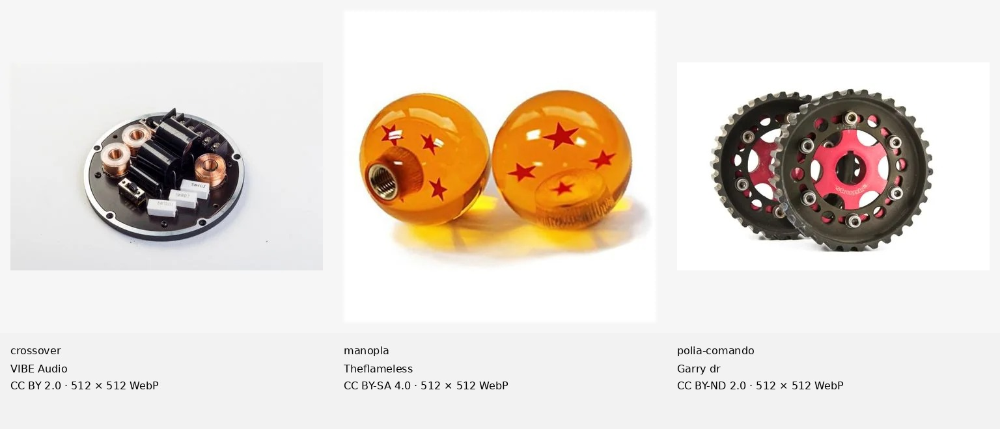

# Reformulação fotográfica — resultado incompleto

**65 de 263 componentes têm foto aprovada (24,71%); 198 continuam pendentes. A meta obrigatória de 100% não foi atingida.** Esta rodada acrescentou três fotografias e preservou integralmente as 62 aprovações anteriores, incluindo os bytes, caminhos e decisões registrados em [preserved-62.json](preserved-62.json). Há 64 arquivos distintos porque um par de aliases compartilha uma fotografia.

O trabalho permanece exclusivamente local. Não houve push, deploy, aplicação de migração em produção ou envio de solicitações a fabricantes. O usuário informou não possuir autorizações prévias ou assinatura de banco de imagens.

## Novas aprovações

| Componente | Fotógrafo/titular declarado | Fonte individual | Licença |
| --- | --- | --- | --- |
| Crossover | VIBE Audio | [BlackDeath 6C](https://www.flickr.com/photos/vibeaudio/9516723638/) | [CC BY 2.0](https://creativecommons.org/licenses/by/2.0/) |
| Manopla de câmbio | Theflameless | [Dragon Ball Z Shift Knob](https://commons.wikimedia.org/wiki/File:Dragon_Ball_Z_Shift_Knob.jpg) | [CC BY-SA 4.0](https://creativecommons.org/licenses/by-sa/4.0/) |
| Polias de comando reguláveis | Garry dr | [Skunk2 camshaft gears](https://www.flickr.com/photos/70241679@N07/6776604261/) | [CC BY-ND 2.0](https://creativecommons.org/licenses/by-nd/2.0/) |

Os originais do crossover e das polias têm 5184 × 3456. A foto da manopla usa a versão licenciada já disponível em cache, de resolução nativa 500 × 500; nova tentativa de obter o original retornou 403. Essa condição consta na evidência e nos créditos. O conteúdo foi reduzido para no máximo 480 px e acomodado em WebP 512 × 512, sem ampliação, corte ou distorção.

Nas polias, a imagem foi preservada integralmente, com alterações técnicas de orientação, dimensão e formato, sem remoção de fundo ou adaptação criativa. A [licença BY-ND 2.0, seção 3](https://creativecommons.org/licenses/by-nd/2.0/legalcode), contempla modificações técnicas necessárias à reprodução em outros meios e formatos; a restrição NoDerivatives continua aplicável. A manopla mantém ShareAlike. As páginas individuais, autores, licenças, dimensões e hashes estão em [source-evidence.json](source-evidence.json); o aplicativo inclui os créditos em `public/modifications/photo-credits.html`.

## Pesquisa de todos os 201 componentes

O processo executou os lotes previstos para os 201 itens, com nove tarefas por componente. Foram **1.809 tentativas de busca**: 1.608 no Flickr e 201 no PxHere, com termos em português e inglês, sinônimos técnicos, buscas por produto, frases exatas e filtro de fundo branco. Houve ainda **201 consultas de descoberta na web** voltadas a fabricantes/fornecedores, além de portfólios fotográficos e categorias do Commons. As consultas exatas, resultados, falhas e caminhos das evidências constam em [plan.json](plan.json) e [component-ledger.json](component-ledger.json).

| Provedor de busca automatizada | Tentativas | Respostas sem erro registrado | Falhas |
| --- | ---: | ---: | ---: |
| Flickr | 1.608 | 1.007 | 601 |
| PxHere | 201 | 181 | 20 |

Os resultados dessas buscas contêm 7.958 entradas distintas por provedor/ID, incluindo fotografias repetidas entre consultas, assuntos irrelevantes e arquivos sem licença aproveitável. **Esse número não representa fotografias adequadas, originais integralmente inspecionados ou aprovações.** Muitas respostas do Flickr omitiram o modelo de resultados: foram registradas como falha, nunca como prova de ausência de fotos. Resultados genéricos de bancos gratuitos também não foram tratados como correspondência técnica.

Foram examinadas pranchas de triagem dos candidatos priorizados: a fila final Flickr tem 426 entradas em 18 pranchas; PxHere, 204 em nove; os portfólios adicionais, 710 em 24 pranchas, com sobreposição entre filas. A ordenação automática por fundo claro serve apenas para triagem e inclui falsos positivos. Cada nova aprovação exigiu conferência do arquivo selecionado e evidência individual de licença. Não se afirma inspeção visual exaustiva de todos os resultados brutos.

A busca adicional em categorias do Commons parou após HTTP 429: 42 categorias foram tentadas, dez tiveram resposta sem erro, 32 tiveram falha, e 52 planejadas não foram executadas. A pesquisa prosseguiu nos outros provedores. Openverse teve timeout e a consulta pública do Unsplash recebeu 401; esses acessos não produziram arquivos aprovados. Ver [additional-sources.json](additional-sources.json).

## Fontes ampliadas e recusas

As páginas públicas de fabricantes e fornecedores foram utilizadas para descoberta e identificação técnica. Não foram consideradas autorização para copiar fotos. Os termos primários e a ação necessária por fonte estão em [source-policies.json](source-policies.json).

Exemplos: [Wilwood](https://www.wilwood.com/About/TermsOfUse), [Holley](https://www.holley.com/terms/), [Bosch](https://www.bosch.com/legal-notice/) e [Pioneer](https://global.pioneer/en/terms/) não forneceram uma licença geral demonstrada para este uso. A permissão de imagens da [SparkFun](https://news.sparkfun.com/735) tem restrição não comercial. Os bancos de imprensa da [Schaeffler](https://www.schaeffler.us/us/news_media/media_library/press_media/?tab=mediathek-pic), [Würth](https://news.wuerth.com/media-library/) e [Dürr](https://www.durr.com/en/media/images-movies) restringem o uso a fins editoriais; o release consultado da [GKN Automotive](https://www.gknautomotive.com/en/news-and-media/latest-news-and-insights/2022/face-spline-joint-technology-by-gkn-automotive/) fala em fins de imprensa. Essas condições não foram estendidas ao catálogo comercial por inferência.

Recusas concretas, registradas em [shortlist.json](shortlist.json):

- Kit de cambagem: a imagem Flickr 18233241310 tem marca Speed Motors e referência a anúncio eBay; a licença declarada pelo uploader não esclarece a titularidade da foto comercial. Exige autorização do titular antes de uso.
- Faróis auxiliares: Flickr 30638970666 é render 3D de Alang7, confirmado no arquivo completo; foi recusado como fotografia, independentemente do filtro de licença.
- Relés: a versão disponível de `Avarrele.jpg` tem resolução limitada para quatro peças e enquadramento inadequado; o arquivo completo não pôde ser obtido. Não foi aprovada para atingir a meta.

Fotografias de veículos completos, peças montadas, componentes de bicicletas/aeronaves, carcaças vazias, material muito desgastado, folhetos e ilustrações também não substituíram os componentes isolados. As 62 imagens anteriores foram preservadas conforme solicitado; algumas mostram contextos de montagem e, por isso, não se declara uniformidade estética integral do catálogo.

## Pendências e caminho para concluir

A relação dos **198 componentes** está em [blocked-items.csv](blocked-items.csv), com nome, categoria, impedimento registrado, consultas/falhas, pistas de fornecedores sem permissão presumida, alternativa necessária e instrução de fotografia própria. [blocked-items.md](blocked-items.md) permite consultar os nomes por categoria. O [painel local de revisão](review.html) mostra as 263 entradas e filtra aprovadas/pendentes.

Cada pendência exige uma fotografia adequada acompanhada de direito de uso verificável. As alternativas documentadas são autorização escrita do titular, licenciamento comercial específico ou fotografia própria com autorização/cessão do fotógrafo. O [modelo de solicitação](authorization-request.md) está preparado para revisão e não foi enviado. A ausência de aprovação nesta pesquisa não prova inexistência mundial de imagem licenciável.

O processo é retomável: `research-photos.py` mantém as buscas em cache e as falhas explícitas; `review-photos.py` verifica a fonte e exige decisão visual antes de aplicar; `build-catalog.mjs` converte proporcionalmente, documenta créditos e confere hashes; `finalize-photo-research.py` atualiza o registro por componente. Nenhuma heurística de busca aprova fotos automaticamente.

## Critérios de aceitação

O estado verificável de cada critério está em [acceptance.json](acceptance.json); os comandos, resultados e limites dos testes repetidos estão em [validation.json](validation.json). As imagens aprovadas foram verificadas em arquivo e no navegador. Aprovação funcional dos testes não equivale a aprovação da cobertura fotográfica: **198 componentes sem fotografia impedem a conclusão definitiva.**
